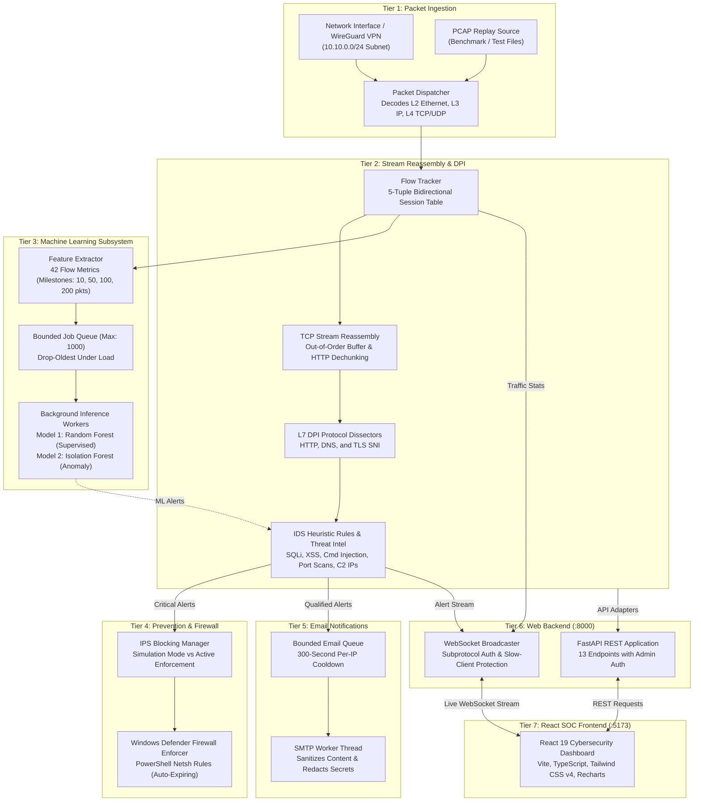
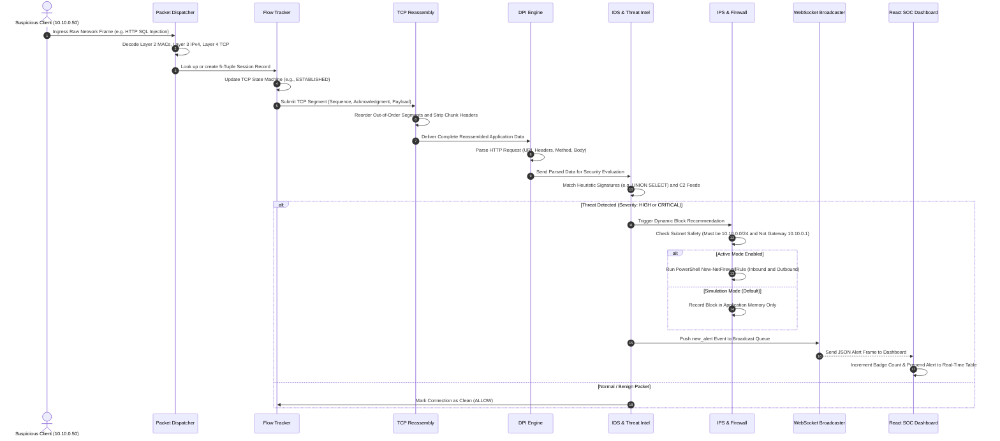
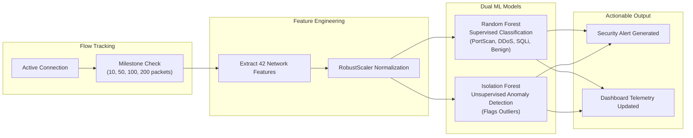
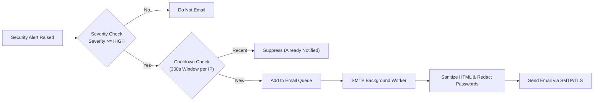
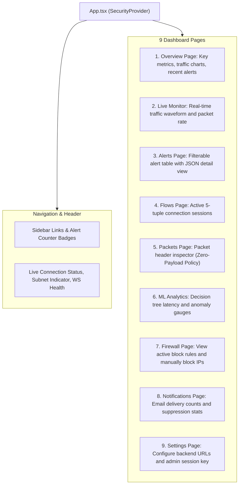

# Deep Packet Inspection (DPI) & Network IDS/IPS Platform — System Architecture, Technical Guide & 50-Question Reference

> **Document Scope**: Complete technical guide, project report resource, and presentation reference for the Deep Packet Inspection (DPI) and Network Intrusion Detection & Prevention System (IDS/IPS).  
> **Technologies Used**: Python 3.12, FastAPI, Asyncio, Scapy, Npcap, Scikit-learn (Random Forest, Isolation Forest), Windows Defender Firewall (`netsh`), React 19, TypeScript, Vite, Tailwind CSS v4, WebSockets, and Recharts.  
> **Safety Boundary**: Restricted to the laboratory VPN subnet `10.10.0.0/24` with automatic safe simulation mode when running without administrator privileges.

---

## Table of Contents

1. [Why This Project Exists (Problem Statement & Purpose)](#1-why-this-project-exists-problem-statement--purpose)
2. [Why We Chose This Technology Stack & Architecture](#2-why-we-chose-this-technology-stack--architecture)
3. [Overall System Architecture & Topology](#3-overall-system-architecture--topology)
4. [Step-by-Step Packet Processing Lifecycle](#4-step-by-step-packet-processing-lifecycle)
5. [Deep Packet Inspection (DPI) & TCP Stream Reassembly](#5-deep-packet-inspection-dpi--tcp-stream-reassembly)
6. [Intrusion Detection System (IDS) & Threat Intelligence](#6-intrusion-detection-system-ids--threat-intelligence)
7. [Machine Learning Pipeline & Anomaly Detection](#7-machine-learning-pipeline--anomaly-detection)
8. [Intrusion Prevention System (IPS) & Windows Firewall Enforcement](#8-intrusion-prevention-system-ips--windows-firewall-enforcement)
9. [REST API Endpoints & Service Mappings](#9-rest-api-endpoints--service-mappings)
10. [WebSocket Real-Time Telemetry Streaming](#10-websocket-real-time-telemetry-streaming)
11. [Automated Security Email Notifications](#11-automated-security-email-notifications)
12. [Frontend Architecture & SOC Dashboard](#12-frontend-architecture--soc-dashboard)
13. [How to Run the Project & Execute Tests](#13-how-to-run-the-project--execute-tests)
14. [50 Essential Project Questions & Detailed Answers](#14-50-essential-project-questions--detailed-answers)
15. [Slide-Ready Presentation Deck (PPT Outline)](#15-slide-ready-presentation-deck-ppt-outline)

---

## 1. Why This Project Exists (Problem Statement & Purpose)

### 1.1 Executive Summary
In computer networks, security threats are constantly evolving. Most conventional firewalls only inspect the outer labels of network traffic (IP addresses and port numbers). They do not look inside the actual message payload. Because modern cyber attacks hide inside standard web traffic (such as HTTP, HTTPS, and DNS), traditional firewalls let them pass straight through.

This project builds a complete, real-time **Network Security Operations Center (SOC) platform**. It combines:
1. **Deep Packet Inspection (DPI)** to reassemble and read application-layer traffic.
2. **Signature-based Intrusion Detection (IDS)** to catch known web and network exploits.
3. **Machine Learning (ML)** to detect new, unknown zero-day anomalies based on traffic behavior.
4. **Active Intrusion Prevention (IPS)** to block confirmed malicious IP addresses automatically via the host firewall.
5. **Real-time Web Dashboard** that visualizes traffic velocity, open flows, active alerts, and firewall rules at 60 frames per second.

---

### 1.2 The Core Problems This Project Solves

#### Problem 1: Port-Based Firewalls Are Blind to Application Attacks
Traditional Layer-3 and Layer-4 firewalls check only four basic things: Source IP, Destination IP, Protocol (TCP or UDP), and Port number (e.g., port 80 for HTTP or port 443 for HTTPS).
- **The Risk**: Attackers do not need special ports to attack a server. They send SQL Injections, Cross-Site Scripting (XSS), or Command Injections directly through standard port 80 or 443.
- **Our Solution**: Layer-7 Deep Packet Inspection (DPI). The system reconstructs the raw TCP byte stream, parses HTTP headers and bodies, and reads the actual request content before deciding whether it is safe.

#### Problem 2: Virtual Private Networks (VPNs) Create Internal Blind Spots
When employees connect remotely over a VPN (such as WireGuard), their traffic travels inside an encrypted tunnel directly into the private network (`10.10.0.0/24`).
- **The Risk**: Once a laptop is inside the VPN perimeter, external boundary firewalls can no longer see what that laptop is doing. If that laptop is infected with malware, it can silently scan internal servers, steal credentials, and move sideways across the company network (lateral movement).
- **Our Solution**: This system monitors and inspects traffic directly on the decrypted VPN interface, securing internal communications between connected VPN clients and internal services.

#### Problem 3: Static Rules Cannot Catch New "Zero-Day" Attacks
Traditional rule-based engines (such as basic regex filters) only detect attacks that security researchers have already seen and cataloged.
- **The Risk**: Attackers modify their payloads, change character encodings, or use brand-new attack patterns (zero-day exploits) that bypass static rules.
- **Our Solution**: Dual-model Machine Learning. Alongside signature checks, the platform runs a **Random Forest classifier** (to categorize known attack families) and an **Isolation Forest anomaly engine** (to flag any connection whose statistical behavior deviates from normal network traffic).

#### Problem 4: Active Prevention Requires a Safe Laboratory Environment
In cybersecurity research, testing an active IPS that blocks network traffic is risky. A single mistake could block the gateway router, disconnect remote administrators, or disrupt the host operating system.
- **Our Solution**: An explicit safety design:
  - The system defaults to **Simulation Mode**, recording blocked packets in memory without changing the operating system.
  - When **Active Mode** is turned on, the system enforces a strict subnet boundary (`10.10.0.0/24`) and permanently protects the gateway (`10.10.0.1`), loopback interface, and management ports from ever being blocked.

---

## 2. Why We Chose This Technology Stack & Architecture

Each technology in this project was selected for clear technical reasons, balancing performance, reliability, and ease of development.

| Component | Selected Technology | Why We Chose It | Alternatives Evaluated | Why the Alternative Was Not Chosen |
| :--- | :--- | :--- | :--- | :--- |
| **Backend Core** | **Python 3.12 & Asyncio** | Native asynchronous event loop, fast development, rich networking libraries, and direct integration with machine learning packages. | C++, Rust, Go | C++ introduces risks of buffer overflows in packet parsers. Rust has a steeper learning curve for quick experimentation. Go has weaker native data science and ML support. |
| **Web API Framework** | **FastAPI + Uvicorn** | High-speed asynchronous handling, automatic OpenAPI/Swagger documentation, and Pydantic validation that matches our frontend TypeScript types. | Flask, Django, Express.js | Flask lacks native async concurrency. Django is too heavy and includes an ORM not needed for real-time telemetry. Express.js lacks built-in strict data validation. |
| **Packet Capture** | **Scapy + Npcap** | Full packet dissection down to raw bytes, support for Ethernet, IP, TCP, UDP, ICMP, and reliable offline PCAP replay. | C-libpcap, Libtins | Raw C libraries require extensive boilerplate and C-bindings, making rapid rule changes and debugging much harder. |
| **Machine Learning** | **Random Forest + Isolation Forest** | **Random Forest** gives fast, transparent classification for known attacks across 42 tabular features.<br>**Isolation Forest** isolates unusual network outliers without needing pre-labeled training data. | Deep Learning (LSTM, CNN), SVM | Deep learning requires GPU hardware, adds 50ms+ inference latency, and acts as an unexplainable "black box." Decision trees run in under 2ms on standard CPUs. |
| **Firewall Enforcement** | **Windows Defender Firewall (`netsh` / PowerShell)** | Native Windows host firewall with zero extra software or kernel drivers required; provides safe, immediate, and reversible IP blocking. | Custom Windows kernel driver (WFP) | Writing custom kernel drivers carries high risk of system crashes (Blue Screen of Death) during traffic bursts. |
| **Frontend Framework** | **React 19 + TypeScript + Vite** | React 19's virtual DOM efficiently renders real-time data; TypeScript guarantees type safety; Vite provides instant development reloads and fast builds. | Next.js, Angular, Vue | Next.js adds server-side rendering complexity unnecessary for an internal SOC tool. Angular is unnecessarily complex for a single-page dashboard. |
| **User Interface Styling** | **Tailwind CSS v4** | Dark-themed, high-density layout designed for security dashboards; compiles down to under 15 kB of CSS with zero runtime performance cost. | Material UI, Styled Components | CSS-in-JS libraries cause re-render performance drops when charts update multiple times per second. |
| **Real-Time Streaming** | **WebSockets with Subprotocol Auth** | Sends live traffic updates every second; uses the `Sec-WebSocket-Protocol` header (`dpi-auth`) to keep authentication keys out of browser URLs and server logs. | Polling REST APIs, URL Query Tokens (`?token=x`) | Polling creates heavy server overhead. Putting tokens in URLs exposes passwords in browser history and proxy access logs. |
| **Concurrency Decoupling** | **Thread-Safe Bounded Queues (`maxsize=1000`)** | Separates fast wire packet capture from slower ML inference and email notifications. Drops oldest tasks if the queue fills up so packets are never dropped. | Synchronous in-line processing | If ML inference takes 5ms during a burst of 10,000 packets per second, synchronous code would freeze the capture loop and drop thousands of packets. |

---

## 3. Overall System Architecture & Topology

The platform uses a **7-tier architecture**. Each layer has a single, focused responsibility and communicates with neighboring layers through clean, non-blocking interfaces:



---

## 4. Step-by-Step Packet Processing Lifecycle

Here is what happens from the millisecond a packet enters the network interface until it appears on the dashboard screen:



---

## 5. Deep Packet Inspection (DPI) & TCP Stream Reassembly

### 5.1 TCP Stream Reassembly (`dpi/tcp_reassembly.py`)
Because the internet breaks data into separate packets, a single web request can arrive in multiple pieces that may be out of order, duplicated, or delayed:
- **Out-of-Order Buffer**: If packet 2 arrives before packet 1, packet 2 is placed in an ordered buffer until packet 1 arrives. Once packet 1 is received, the pieces are combined in the correct order.
- **Duplicate Removal**: Retransmitted packets are detected and clipped so data is not duplicated.
- **HTTP Chunk Decoding**: Reassembles chunked HTTP streams (`Transfer-Encoding: chunked`), removing chunk-size headers and merging body chunks into a single message.
- **HTTP Smuggling Defense**: Flags any request that includes both a `Content-Length` header and a `Transfer-Encoding` header, or conflicting length values (RFC 7230 violation), immediately raising an alert.
- **Memory Protection**: Enforces a limit of 32 out-of-order packets per connection and a 30-second inactivity timeout. Inactive or incomplete streams are purged to save memory.

### 5.2 HTTP Protocol Dissector (`dpi/http_inspection.py`)
- Reads HTTP methods (`GET`, `POST`, `PUT`, `DELETE`).
- Extracts requested URLs, query parameters, and protocol versions.
- Parses key headers: `Host`, `User-Agent`, `Authorization`, `Cookie`, and `Content-Type`.
- Inspects up to **64KB** of request body data, ignoring oversized binary files (such as images or videos) to keep processing fast.

### 5.3 DNS Protocol Dissector (`dpi/dns_inspection.py`)
- Decodes DNS queries and answers on port 53 (UDP and TCP).
- Extracts requested domain names, record types (`A`, `AAAA`, `TXT`, `MX`, `CNAME`), and response codes.
- Computes **Shannon Entropy** on domain names to detect data exfiltration:
  $$\text{Entropy} = -\sum P(x) \log_2 P(x)$$
  Standard domains (like `google.com`) have low entropy (2.0 to 3.0). Stolen data encoded into subdomains (like `4a6f686e446f65.evil.com`) produces high entropy (> 3.5). Queries exceeding 30 characters with high entropy trigger a `SUSPICIOUS_DNS` alert.

### 5.4 TLS Metadata Dissector (`dpi/tls_inspection.py`)
- Inspects the unencrypted initial **TLS ClientHello** handshake frame.
- Extracts the **Server Name Indication (SNI)** extension, TLS version, and supported encryption cipher suites.
- Cross-references the destination domain against malicious domain blacklists without decrypting the user's private encrypted session.

---

## 6. Intrusion Detection System (IDS) & Threat Intelligence

The IDS engine uses signature rules, behavioral tracking, and threat intelligence to identify attacks across multiple network layers.

### 6.1 Application Threat Detectors (`ids/http_threat_detectors.py`)

| Attack Type | What the Engine Looks For | Severity | Evidence Saved for Forensics |
| :--- | :--- | :--- | :--- |
| **SQL Injection (SQLi)** | Database commands injected into web inputs: `UNION SELECT`, `' OR '1'='1'`, `; DROP TABLE`, and comment markers (`--`, `/*`). | `HIGH` | Matched SQL keyword, URL parameter, full query string. |
| **Cross-Site Scripting (XSS)** | Malicious scripts injected into inputs: `<script>`, `javascript:`, DOM event triggers (`onload=`, `onerror=`), and script functions (`eval()`, `document.cookie`). | `HIGH` | Script tag payload, attribute name, URL path. |
| **Path Traversal** | Attempts to escape the web root directory: `../`, `..%2f`, Windows paths (`..\..\`), and requests for sensitive files (`/etc/passwd`, `win.ini`). | `HIGH` | Directory path string, target system file. |
| **Command Injection** | Shell execution commands: chaining symbols (`\|`, `&&`, `;`, `$()`) paired with system binaries (`whoami`, `curl`, `bash`, `powershell`). | `CRITICAL` | Shell operator, executed system command. |

### 6.2 Network Behavioral Detectors (`ids/ids_engine.py`)
- **TCP Port Scanning**: Detects when a single IP attempts to connect to 15 or more distinct ports within a 5-second sliding window.
- **SYN Flood Attacks**: Tracks incomplete TCP connection attempts. If an IP sends more than 30 SYN packets per second without finishing the three-way handshake, a critical alert is triggered.
- **TTL Variance & Spoofing**: Tracks the Time-to-Live (TTL) hop count of packets in an active connection. Sudden changes in TTL indicate that someone is spoofing the sender's IP address.

### 6.3 Threat Intelligence Engine (`ids/threat_intel.py`)
- Compares live IP addresses and domains against curated Threat Intelligence feeds.
- Pre-loaded with known Command-and-Control (C2) servers, such as Cobalt Strike beacon addresses (`198.51.100.23`).
- Uses an in-memory **Radix Tree (Trie)** to perform IP and CIDR subnet lookups in sub-microsecond time.

---

## 7. Machine Learning Pipeline & Anomaly Detection



### 7.1 The 42 Network Flow Features
The system computes 42 statistical metrics directly from ongoing connection flows without storing entire files:
1. **Flow Timing**: Connection duration, forward inter-arrival time mean/max/std, backward inter-arrival times.
2. **Packet Sizes**: Forward and backward mean packet lengths, standard deviations, and variance.
3. **Traffic Velocity**: Flow packets per second, flow bytes per second.
4. **TCP Flags**: Counts of `SYN`, `FIN`, `RST`, `PSH`, `ACK`, and `URG` flags.
5. **Directional Balance**: Header lengths, ratio of download bytes to upload bytes.

### 7.2 Why We Use Dual Models
1. **Random Forest Classifier (Supervised)**:
   - Trained on labeled network flows.
   - Accurately identifies known attack families (e.g., Port Scans, Denial of Service, SQL Injections) with confidence probability scores.
2. **Isolation Forest Anomaly Engine (Unsupervised)**:
   - Does not require pre-labeled attack data.
   - Measures how many random decision splits are needed to isolate a data point. Rare or abnormal traffic patterns require fewer splits and receive an anomaly score, allowing the system to flag novel zero-day attacks.

### 7.3 Efficient Runtime Processing
- **Milestone Evaluation**: Instead of calculating heavy ML features on every single packet, the system evaluates connections at milestone packet counts: **10, 50, 100, and 200 packets**. This captures threats early while saving CPU power.
- **Bounded Queue**: Feature vectors are placed into a bounded queue (`maxsize=1000`). If traffic surges, the queue drops the oldest jobs (`drop-oldest`), ensuring the packet capture thread never freezes.

---

## 8. Intrusion Prevention System (IPS) & Windows Firewall Enforcement

### 8.1 Safety Rules & Subnet Boundaries
- **Strict Subnet Scope**: The firewall enforcer can only block IP addresses inside the laboratory VPN subnet: `10.10.0.0/24`.
- **Permanent Immunity List**: Critical infrastructure addresses can **never** be blocked:
  - Gateway router (`10.10.0.1`)
  - Loopback addresses (`127.0.0.0/8`)
  - Broadcast and multicast addresses
  - WireGuard VPN server port (`51820`)
- **Automatic Fallback to Simulation**: If the platform is started without Windows Administrator rights, it automatically runs in **Simulation Mode**, logging blocked connections in memory without touching the real operating system.

### 8.2 Windows Defender Firewall Commands
When running with administrator privileges in active mode, the system executes PowerShell commands to create native inbound and outbound block rules:

```powershell
# Block Inbound Traffic from Malicious IP
New-NetFirewallRule -Name 'NIPS_BLOCK_10.10.0.50' -DisplayName 'NIPS_BLOCK_10.10.0.50' `
  -Direction Inbound -Action Block -RemoteAddress '10.10.0.50' `
  -PolicyStore ActiveStore -Description 'NIPS temporary inbound block' -Enabled True

# Block Outbound Traffic to Malicious IP
New-NetFirewallRule -Name 'NIPS_BLOCK_10.10.0.50_OUT' -DisplayName 'NIPS_BLOCK_10.10.0.50_OUT' `
  -Direction Outbound -Action Block -RemoteAddress '10.10.0.50' `
  -PolicyStore ActiveStore -Description 'NIPS temporary outbound block' -Enabled True
```

### 8.3 Automatic Rule Expiration
- Every block rule includes an expiration time (default: 300 seconds, configurable up to 24 hours).
- A background maintenance thread checks rule ages every 10 seconds. When a rule expires, the system automatically removes it using `Remove-NetFirewallRule`, preventing old rules from piling up.

---

## 9. REST API Endpoints & Service Mappings

The FastAPI backend runs on port 8000 and provides versioned, non-blocking REST endpoints under `/api/v1/`:

| Method | Endpoint Path | Parameters / Headers | Controller / Service | Description & Guarantees |
| :--- | :--- | :--- | :--- | :--- |
| `GET` | `/api/v1/health` | None | `health_router` | Checks system health (DPI pipeline, ML engine, and notification worker). |
| `GET` | `/api/v1/stats` | None | `statsApi.getStatistics` | Returns total packet counts, byte rates, active flows, and alert breakdowns. |
| `GET` | `/api/v1/alerts` | `limit`, `offset`, `severity`, `category` | `alertsApi.getAlerts` | Paginated list of security alerts with filtering. Omits raw payload bytes. |
| `GET` | `/api/v1/alerts/{id}` | Path: `alert_id: int` | `alertsApi.getAlertById` | Detailed view of a single alert, including matched signature and evidence string. |
| `GET` | `/api/v1/flows` | `limit`, `offset`, `protocol`, `is_active`| `flowsApi.getFlows` | Paginated active and past 5-tuple connection flows, byte totals, and TCP state. |
| `GET` | `/api/v1/flows/{id}` | Path: `flow_id: int` | `flowsApi.getFlowById` | In-depth session statistics, packet counts, and TCP flags for a specific flow. |
| `GET` | `/api/v1/packets` | `limit=50` (max: 100), `offset=0` | `packetsApi.getPackets` | **Zero-Payload Policy**: Returns header metadata only; raw payloads are excluded for privacy. |
| `GET` | `/api/v1/ml/status` | None | `mlApi.getStatus` | Shows model operational status, queue depth, and memory availability. |
| `GET` | `/api/v1/ml/metrics` | None | `mlApi.getMetrics` | ML performance telemetry: processed jobs, drop counts, and average latency. |
| `GET` | `/api/v1/firewall/rules` | None | `firewallApi.getRules` | Lists active firewall rules, time remaining, and mode (`SIMULATION` vs `ACTIVE`). |
| `POST` | `/api/v1/firewall/block` | Header: `X-API-Key`<br>Body: `{ ip, duration, reason }` | `firewallApi.blockIp` | Blocks an IP address. Requires admin key. Enforces the `10.10.0.0/24` subnet limit. |
| `DELETE` | `/api/v1/firewall/block/{id}`| Header: `X-API-Key`<br>Path: `rule_id: str` | `firewallApi.unblockRule` | Removes an active firewall block rule. Requires admin authentication. |
| `GET` | `/api/v1/notifications/status`| None | `notificationsApi.getStatus`| Email delivery metrics (sent, queued, suppressed). Strictly omits passwords. |

---

## 10. WebSocket Real-Time Telemetry Streaming

The WebSocket endpoint (`WS /ws/monitor`) streams live traffic updates and security alerts to connected dashboards every second.

### 10.1 Secure Subprotocol Authentication
To prevent secret API tokens from being exposed in browser address bars, history, or web proxy logs, the dashboard authenticates using the standard `Sec-WebSocket-Protocol` header:
```typescript
// frontend/src/services/websocket.ts
const protocols = this.token ? ["dpi-auth", this.token] : [];
this.socket = new WebSocket("ws://127.0.0.1:8000/ws/monitor", protocols);
```
On the server side, Python validates the token using constant-time string comparison (`secrets.compare_digest`) to prevent timing side-channel attacks.

### 10.2 Standard JSON Telemetry Message
```json
{
  "event": "traffic_update",
  "timestamp": "2026-11-12T19:00:00.000000+00:00",
  "data": {
    "packets_per_sec": 420.5,
    "bytes_per_sec": 384000.0,
    "total_packets": 128450,
    "total_bytes": 104857600,
    "active_flows": 24,
    "total_flows": 182,
    "active_workers": 4,
    "total_alerts": 18,
    "total_blocks": 2
  }
}
```

### 10.3 Slow-Client Protection
Each connected browser maintains an independent queue (`maxsize=100`). If a single client's network lags and its queue fills up, the server drops messages for that client only. The central packet processor and all other connected dashboards continue running smoothly.

---

## 11. Automated Security Email Notifications



- **300-Second Cooldown**: If an attacker launches thousands of scan packets per second, the system sends an email for the first alert and suppresses subsequent emails for that IP address for 5 minutes, protecting mail quotas.
- **Credential Redaction**: Before rendering HTML email templates, the system automatically scrubs passwords, authentication tokens, and session cookies from forensic evidence strings.
- **Background Worker**: Email delivery runs in a separate background thread so that slow SMTP connections never delay packet processing.

---

## 12. Frontend Architecture & SOC Dashboard

The web dashboard is built using **React 19, TypeScript, Vite, and Tailwind CSS v4**.



### Frontend Performance & Security Highlights
- **Vite Code Splitting**: The build output is split into separate cached chunks (`vendor-recharts`, `vendor-icons`, `vendor-router`, `index`), keeping every JavaScript file under 500 kB for fast loading.
- **In-Memory Credential Security**: The administrator key is stored exclusively in React application memory. It is **never saved to localStorage, sessionStorage, or browser cookies**, protecting it from malicious browser extensions.
- **Memory Bounding**: The live alert table keeps a maximum of 50 records in browser memory, preventing browser tab crashes during long monitoring sessions.

---

## 13. How to Run the Project & Execute Tests

### Prerequisites
1. **Operating System**: Windows 10/11 (or Linux)
2. **Python**: Python 3.12+ (64-bit) installed and added to your `PATH`
3. **Node.js**: Node.js 18+ or 20+ installed

---

### Option A: One-Click Launch (Recommended for Windows)

From the project root folder, open PowerShell and run:
```powershell
.\start_soc_system.ps1
```
This script automatically starts both the FastAPI backend (port 8000) and the React Vite development server (port 5173).

---

### Option B: Manual Launch Step-by-Step

#### Step 1: Set Up and Start Python Backend
Open **Terminal 1**:
```powershell
cd C:\Users\kanva\Desktop\final_project\project_networking1

# Create and activate virtual environment
python -m venv .venv
.\.venv\Scripts\Activate.ps1

# Install requirements
pip install --upgrade pip
pip install -r requirements.txt

# Start FastAPI server
$env:PYTHONPATH="."
.\.venv\Scripts\python -m uvicorn backend.api.main:create_app --factory --host 127.0.0.1 --port 8000
```

#### Step 2: Set Up and Start React Frontend
Open **Terminal 2**:
```powershell
cd C:\Users\kanva\Desktop\final_project\project_networking1\frontend

# Install dependencies
npm install

# Start development server
npm run dev
```

#### Step 3: Open the Dashboard
Open your web browser and go to **`http://127.0.0.1:5173`**. The topbar indicator will turn green and display **`WS CONNECTED`**.

---

### Running Automated Test Suites

#### Run Backend Tests (137 Pytest Tests)
```powershell
cd C:\Users\kanva\Desktop\final_project\project_networking1
$env:PYTHONPATH="."
.\.venv\Scripts\python -m pytest tests/
```

#### Run Frontend Tests (Vitest)
```powershell
cd C:\Users\kanva\Desktop\final_project\project_networking1\frontend
npm test
```

#### Run Frontend Production Build
```powershell
cd C:\Users\kanva\Desktop\final_project\project_networking1\frontend
npm run build
```

---

## 14. 50 Essential Project Questions & Detailed Answers

---

### Domain 1: Computer Networking & Deep Packet Inspection (Q1 – Q10)

#### Q1: What is the difference between Shallow Packet Inspection and Deep Packet Inspection (DPI)?
Shallow packet inspection looks only at packet headers at Layer 3 (IP addresses) and Layer 4 (port numbers). Deep Packet Inspection (DPI) goes further by reassembling packets into full data streams and reading the Layer-7 application content (such as HTTP request methods, headers, URLs, and POST bodies). DPI is required because modern web attacks occur inside standard open ports (such as port 80 or 443).

#### Q2: What is an IP 5-tuple, and why is it used to track connections?
An IP 5-tuple consists of: Source IP, Destination IP, Source Port, Destination Port, and Protocol (TCP or UDP). It uniquely identifies a two-way conversation between two computers. The Flow Tracker hashes this 5-tuple symmetrically so that requests and their corresponding replies match the same connection session.

#### Q3: How does the system handle out-of-order TCP packets?
In packet-switched networks, packets can arrive out of order. In `dpi/tcp_reassembly.py`, packets that arrive ahead of schedule are placed into a temporary buffer sorted by their TCP sequence number. When the missing packet arrives, the engine stitches the data together in the correct sequence before sending it to the application dissectors.

#### Q4: How does the system defend against HTTP Request Smuggling?
HTTP Request Smuggling occurs when an attacker includes conflicting message-framing headers (such as both a `Content-Length` and a `Transfer-Encoding: chunked` header) to trick proxy servers and backend servers into interpreting request boundaries differently. Our HTTP dissector strictly enforces RFC 7230: any request with conflicting framing headers is flagged as an attack and raises an immediate security alert.

#### Q5: How can the system inspect encrypted HTTPS traffic without decrypting user data?
During the initial connection handshake, before encryption begins, the client sends an unencrypted **TLS ClientHello** packet. In `dpi/tls_inspection.py`, our engine reads this packet to extract the **Server Name Indication (SNI)** extension, which shows the destination website domain. It also checks the TLS version and cipher suites against reputation blacklists without decrypting the private session.

#### Q6: How does the DNS dissector calculate Shannon Entropy, and why?
Shannon Entropy measures character randomness in a text string. Standard domain names look like regular words and have low entropy (2.0 to 3.0). When malware uses DNS to secretly steal data, it encodes the data into long, random-looking subdomains (like `8f3a9b1c.malicious.com`), which produces high entropy (> 3.5). Queries exceeding 30 characters with high entropy trigger a `SUSPICIOUS_DNS` alert.

#### Q7: What stops an attacker from exhausting memory by sending out-of-order packets?
An attacker could try a denial-of-service attack by sending packets with large gaps in sequence numbers, forcing the server to buffer data forever. We prevent this with three safeguards: a maximum limit of 32 buffered segments per connection, a global memory buffer limit, and a 30-second inactivity timeout that purges incomplete streams.

#### Q8: What is the purpose of the Berkeley Packet Filter (BPF)?
BPF is a mechanism that compiles packet filtering rules (e.g., `ip and (tcp or udp)`) into kernel-level instructions. This allows the network driver (Npcap) to discard unwanted packets immediately in the kernel before wasting CPU power passing them to Python user space.

#### Q9: How does the system reassemble fragmented IPv4 packets?
If an IP packet is larger than the network Maximum Transmission Unit (MTU), the sending router breaks it into fragments. In `parser/packet_dispatcher.py`, fragments sharing the same IP Identification number, Source IP, and Destination IP are buffered by offset. When all fragments arrive, the full IP datagram is reassembled before TCP or UDP decoding.

#### Q10: Why is HTTP body inspection limited to 64KB?
Limiting body inspection to 64KB prevents large file uploads (such as video or zip files) from slowing down the system. Almost all web attacks (SQL injection, shell commands, path traversal) occur in the URL parameters, headers, or initial request body, so inspecting the first 64KB catches exploits while preserving fast processing speeds.

---

### Domain 2: Intrusion Detection & Threat Intelligence (Q11 – Q20)

#### Q11: How does the SQL Injection (SQLi) detector work?
In `ids/http_threat_detectors.py`, compiled regular expressions scan URLs, query parameters, and request bodies for database attack syntax: boolean conditions (`' OR '1'='1'`), union queries (`UNION SELECT`), stacked queries (`; DROP TABLE`), and comment symbols (`--`, `/*`).

#### Q12: How does the Cross-Site Scripting (XSS) detector work?
The XSS detector searches for malicious scripts in user input. It looks for `<script>` tags, `javascript:` URL schemes, DOM event attributes (`onload=`, `onerror=`), and JavaScript execution functions (`eval()`, `document.cookie`).

#### Q13: What is Path Traversal, and how is it detected?
Path traversal occurs when an attacker tries to access files outside the website's public folder by using relative directory commands. The detector flags patterns like `../`, `..%2f`, and direct references to critical operating system files such as `/etc/passwd` or `win.ini`.

#### Q14: How does Command Injection detection work, and why is its severity CRITICAL?
Command injection occurs when an attacker tries to execute operating system commands through a web application. The detector looks for shell chaining operators (`|`, `&&`, `;`) combined with system commands like `whoami`, `curl`, `bash`, or `powershell`. It is marked CRITICAL because successful execution gives the attacker complete control over the host server.

#### Q15: How does the system detect TCP Port Scanning?
In `ids/ids_engine.py`, the system tracks the unique destination ports probed by each source IP address. If a single IP attempts to connect to 15 or more different ports within 5 seconds, the engine flags it as a `PORT_SCAN`.

#### Q16: How does the SYN Flood detector operate?
In a normal TCP connection, a client sends a SYN packet, the server replies with SYN/ACK, and the client sends an ACK to complete the handshake. In a SYN flood, an attacker sends massive numbers of SYN packets and never completes the handshake. If an IP sends more than 30 SYN packets per second without completing handshakes, a critical `SYN_FLOOD` alert is raised.

#### Q17: What is an Indicator of Compromise (IOC)?
An IOC is a piece of digital forensic evidence (such as a known malicious IP address, domain name, or file hash) associated with cyber attacks. In `ids/threat_intel.py`, traffic is compared against verified threat lists, such as Cobalt Strike Command-and-Control (C2) server addresses (`198.51.100.23`).

#### Q18: What data structure is used for fast Threat Intelligence IP lookups?
The engine uses an in-memory **Radix Tree (Trie)**. This tree structure indexes IP addresses and CIDR subnets by their binary prefixes, allowing lookups to complete in sub-microsecond time regardless of how many thousands of IPs are in the blacklist.

#### Q19: What is Domain Generation Algorithm (DGA) detection?
Malware often uses DGAs to generate hundreds of random domain names every day to contact Command-and-Control servers. The DGA detector evaluates the vowel-to-consonant ratio, numeric character percentage, and letter patterns to identify machine-generated domains.

#### Q20: What is TTL Variance detection, and what does it reveal?
The Time-to-Live (TTL) header counts how many router hops a packet takes to reach its destination. Within a single ongoing TCP connection, TTL values should remain consistent. A sudden change in TTL indicates that an attacker is spoofing the sender's IP address from a different location.

---

### Domain 3: Machine Learning & Behavioral Analytics (Q21 – Q30)

#### Q21: Why combine a Random Forest classifier with an Isolation Forest anomaly detector?
Random Forest is a supervised model trained on known attacks (such as Port Scans, DDoS, and SQL Injection) and classifies them accurately. Isolation Forest is an unsupervised model that does not require pre-labeled data; it detects when traffic behavior looks abnormal, allowing the system to catch brand-new zero-day attacks that have no existing rules.

#### Q22: How does an Isolation Forest detect anomalies?
Isolation Forest builds random decision trees. Normal data points are clustered together and require many splits to isolate. Anomalous data points have unusual feature values and are isolated very quickly with few splits. Shorter path lengths in the trees identify abnormal network behavior.

#### Q23: Why evaluate ML features at milestones (10, 50, 100, 200 packets) instead of on every packet?
Calculating 42 statistical metrics on every single packet would overload the CPU. Evaluating at milestones (10, 50, 100, and 200 packets) gives the connection enough time to establish statistical patterns while still catching attacks early.

#### Q24: What is "Session Correlation Leakage" in network ML training?
In network datasets like CICIDS2017, packets from the same connection share identical characteristics (like window size and TTL). If data is split randomly into training and testing sets, packets from the same connection end up in both sets, causing the model to get artificially high test scores (>99%) through simple memorization. To test true accuracy, data must be split by host IP or by capture day (GroupKFold).

#### Q25: Why is RobustScaler used instead of StandardScaler for network features?
Network traffic features contain extreme spikes (for example, millions of bytes during a flood). `StandardScaler` uses the mathematical mean and variance, which are distorted by extreme spikes. `RobustScaler` scales data using the median and Interquartile Range (IQR), making it immune to extreme outlier distortion.

#### Q26: What happens if the ML inference queue fills up during a traffic burst?
The ML runtime uses a bounded queue (`maxsize=1000`). If the queue fills up, it drops the oldest pending ML job (`drop-oldest`). This ensures that the primary packet capture engine continues running without dropping network packets.

#### Q27: What network features are most important for detecting port scans?
The most important features are the number of connection request flags (`syn_count`), very small average packet sizes (`fwd_pkt_len_mean` around 40 to 60 bytes), high packets per second (`flow_pkts_per_sec`), and an upload-to-download ratio near zero because closed ports do not return data.

#### Q28: How does the system calculate Inter-Arrival Time (IAT)?
Inter-arrival time is the elapsed time between consecutive packets in a connection ($\Delta t = t_k - t_{k-1}$). The system tracks forward and backward packet times separately and calculates the average, maximum, and standard deviation for each connection.

#### Q29: How does the system prevent false alarms on large legitimate downloads?
A large file download creates high traffic volume that might look like an attack. The system prevents false alarms by checking connection context: legitimate downloads have established TCP handshakes, matching acknowledgments, and valid TLS encryption framing.

#### Q30: How are machine learning results converted into security alerts?
In `ml/runtime/engine.py`, if the Random Forest probability exceeds 0.85 or the Isolation Forest score indicates a clear outlier, the engine generates an alert with category `ML_ANOMALY` or the specific attack name and sends it to the dashboard.

---

### Domain 4: Intrusion Prevention & Firewall Enforcement (Q31 – Q38)

#### Q31: What is the difference between an IDS and an IPS?
An Intrusion Detection System (IDS) is passive: it observes network traffic and generates log alerts when a threat is detected. An Intrusion Prevention System (IPS) is active: upon detecting a critical threat, it immediately intervenes to drop packets or configure firewall rules to block the attacker.

#### Q32: Why does the platform support both SIMULATION mode and ACTIVE mode?
Modifying real operating system firewall rules can disrupt network connectivity. In automated test suites and student lab settings, the system defaults to `SIMULATION` mode: it logs drops in memory without altering the operating system. `ACTIVE` mode executes real Windows Defender Firewall rules.

#### Q33: How does the system ensure firewall commands cannot be exploited for Command Injection?
In `ips/windows_firewall_enforcer.py`:
1. Every IP address is parsed with Python's `ipaddress.ip_address()`; invalid strings raise an error immediately.
2. The address is checked to verify it belongs to the allowed subnet `10.10.0.0/24`.
3. Commands are passed to `subprocess.Popen` as a strict list of arguments with `shell=False`, preventing shell command injection.

#### Q34: What prevents the firewall from accidentally blocking administrators?
The system has a hardcoded immunity list: the VPN gateway (`10.10.0.1`), loopback addresses (`127.0.0.0/8`), broadcast addresses, and the WireGuard port (`51820`) can never be blocked under any circumstances.

#### Q35: How does automatic firewall rule expiration work?
Every block rule has a lifetime timer (default: 300 seconds). A background thread checks active rules every 10 seconds. When a rule's timer expires, the thread runs `Remove-NetFirewallRule` to remove the block from Windows Firewall, preventing stale rules from accumulating.

#### Q36: Why does the firewall enforcer use `-PolicyStore ActiveStore` in PowerShell?
Writing to `ActiveStore` applies firewall rules directly in volatile system memory. If the computer restarts, temporary blocks are wiped clean and will not permanently alter system settings.

#### Q37: What happens if the server is started without Windows Administrator rights?
On startup, the system checks administrator status using Windows API `shell32.IsUserAnAdmin()`. If administrator privileges are missing, the server logs a warning and automatically runs in safe **Simulation Mode** rather than crashing.

#### Q38: Can an attacker spoof their IP address to cause the firewall to block someone else?
For full TCP attacks (such as SQL injection or web exploits), an attacker cannot spoof their IP address because TCP requires completing a three-way handshake (`SYN -> SYN/ACK -> ACK`). A spoofed IP address never receives the `SYN/ACK` packet and cannot send application data. In addition, all critical infrastructure addresses are permanently immune.

---

### Domain 5: Backend Concurrency, REST & WebSockets (Q39 – Q44)

#### Q39: Why use WebSocket subprotocol authentication instead of URL query parameters?
URL query parameters (`ws://host/ws?token=SECRET`) are saved in plain text in browser histories, proxy access logs, and web server logs. Subprotocol authentication (`Sec-WebSocket-Protocol: ["dpi-auth", token]`) sends the key inside the HTTP upgrade headers, keeping the URL completely clean.

#### Q40: Why use `secrets.compare_digest` instead of `==` to verify API keys?
The standard Python `==` comparison stops checking as soon as it finds the first mismatched character. An attacker measuring microscopic response times can guess passwords character by character. `secrets.compare_digest` takes the exact same amount of time regardless of how many characters match, preventing timing attacks.

#### Q41: How does the WebSocket manager protect against slow clients?
Each connected web client has an independent queue (`maxsize=100`). When broadcasting updates, the server uses non-blocking `put_nowait()`. If a client's queue fills up due to network lag, the server drops messages for that client only, preventing other users from slowing down.

#### Q42: What is the "Zero-Payload Policy" on the `/api/v1/packets` endpoint?
To protect user privacy and prevent data theft, the packet inspection endpoint returns only packet headers (IP addresses, ports, protocol names, and packet sizes). Raw packet contents and payload bytes are never exposed in the API.

#### Q43: How does the backend prevent email flooding during an attack?
In `backend/services/notification/notification_manager.py`, an alert cooldown tracker remembers the source IP and attack type. If the same attack occurs again within 300 seconds, the system logs it as suppressed and does not send another email.

#### Q44: What happens if the backend restarts while users have the dashboard open?
The frontend WebSocket manager includes an automatic reconnection loop with exponential backoff (2 to 30 seconds). When the backend comes back online, the dashboard reconnects automatically without requiring the user to refresh the page.

---

### Domain 6: Frontend SOC Design, Security & Scalability (Q45 – Q50)

#### Q45: Why is the admin API key stored in React memory instead of `localStorage`?
Data saved in browser `localStorage` or `sessionStorage` can be read and stolen by malicious browser extensions or Cross-Site Scripting (XSS) scripts. Storing the key in React application memory keeps it safe and ensures it is wiped clean as soon as the browser tab is closed.

#### Q46: How does the React dashboard maintain smooth 60 FPS performance during high traffic?
1. Traffic graphs update on a controlled 1.0-second interval rather than redrawing on every incoming packet.
2. The alert stream is deduplicated by alert ID and capped at 50 records in memory.
3. Chart animation effects are disabled (`isAnimationActive={false}`) to save CPU rendering cycles.

#### Q47: Why did we configure Vite `manualChunks` code splitting?
Without code splitting, the frontend compiled into a single massive 835 kB JavaScript file. By splitting third-party libraries into separate chunks (`vendor-recharts`, `vendor-router`, `vendor-icons`, `index`), each file stays under 500 kB, making pages load much faster.

#### Q48: How does the dashboard show the difference between an alert, a simulated block, and an active block?
The dashboard uses distinct visual badges:
- **Alert**: Yellow badge indicating a detected threat.
- **Simulation Drop**: Amber shield indicating the packet was dropped in application memory only.
- **Active Block**: Red shield displaying the active Windows Defender Firewall rule name.

#### Q49: How does the backend protect against Cross-Origin Resource Sharing (CORS) attacks?
The FastAPI backend disallows wildcard access (`*`) when credentials are enabled. It enforces a strict whitelist allowing only local development origins (`http://localhost:5173` and `http://127.0.0.1:5173`), preventing unauthorized websites from reading API data.

#### Q50: How could this architecture scale to handle 10 Gbps enterprise traffic?
1. **Kernel Bypass**: Replace Scapy/Npcap with **DPDK** or Linux **eBPF / AF_XDP** to process packets directly from network cards without kernel overhead.
2. **Multi-Core Scaling**: Use Receive Side Scaling (RSS) on network cards to distribute connection flows across multiple CPU cores.
3. **High-Speed Languages**: Implement the packet capture and stream reassembly core in **Rust or C++**.
4. **Distributed Telemetry**: Stream alerts and flow metadata to an **Apache Kafka** cluster feeding distributed analytics databases like ClickHouse.

---

## 15. Slide-Ready Presentation Deck (PPT Outline)

Use these concise slide outlines for creating project presentation slides:

---

### Slide 1: Title & Executive Summary
- **Title**: Deep Packet Inspection (DPI) & Network IDS/IPS Platform.
- **Goal**: Build a complete, real-time Network Security Operations Center (SOC) system to detect and prevent modern cyber attacks.
- **Core Problem**: Traditional firewalls only look at port numbers; modern web attacks hide inside legitimate ports (80, 443, 53).
- **Our Solution**: Deep Packet Inspection + Heuristic Signatures + Machine Learning + Automated Firewall Blocking + Live React Dashboard.

---

### Slide 2: Technology Stack & Architectural Decisions
- **Backend Core**: Python 3.12 with `asyncio` for non-blocking I/O.
- **Ingestion**: Scapy + Npcap for raw Ethernet and IP packet capture and PCAP replay.
- **Web API**: FastAPI (ASGI) with Pydantic v2 validation and WebSockets for live telemetry.
- **Machine Learning**: Random Forest (Supervised) + Isolation Forest (Unsupervised Anomaly Detection).
- **Enforcement**: Windows Defender Firewall (`netsh` / PowerShell) bounded strictly to the `10.10.0.0/24` subnet.
- **Frontend**: React 19, TypeScript, Vite, Tailwind CSS v4, and Recharts.

---

### Slide 3: Deep Packet Inspection & Stream Reassembly
- **TCP Stream Reassembly**:
  - Reorders out-of-order packets and eliminates duplicate segments.
  - Automatically dechunks `Transfer-Encoding: chunked` HTTP data.
  - Defends against HTTP Request Smuggling (RFC 7230).
  - 30-second sliding timeout protects against memory bloat.
- **Protocol Dissectors**:
  - **HTTP**: Parses methods, URLs, headers, and request bodies (up to 64KB).
  - **DNS**: Computes Shannon Entropy (>3.5) to catch data exfiltration and tunneling.
  - **TLS**: Extracts Server Name Indication (SNI) from the ClientHello handshake without decrypting user data.

---

### Slide 4: Hybrid Intrusion Detection: Signatures + Machine Learning
- **Heuristic Signatures**:
  - Catches SQL Injection, Cross-Site Scripting (XSS), Path Traversal, and Command Injection.
  - Detects TCP Port Scanning (15+ ports in 5s) and SYN Floods (30+ SYN/s).
  - Matches traffic against Threat Intelligence C2 feeds (Cobalt Strike) using an in-memory Radix Tree.
- **Dual Machine Learning**:
  - Extracts 42 statistical flow features (packet lengths, inter-arrival times, TCP flag counts).
  - Evaluated at milestone packet counts: 10, 50, 100, 200 packets.
  - Non-blocking queue (`maxsize=1000`) with drop-oldest policy guarantees zero packet drops.

---

### Slide 5: Prevention, Firewall Enforcement & Safety
- **Dual Enforcement Modes**:
  - **Simulation Mode** (Default): Records drops in memory without altering the operating system.
  - **Active Mode**: Injects native PowerShell rules into Windows Defender Firewall (`-PolicyStore ActiveStore`).
- **Safety Boundaries**:
  - Hardcoded subnet restriction: only addresses in `10.10.0.0/24` can be blocked.
  - Gateway router (`10.10.0.1`), loopback, and VPN ports are permanently immune.
  - Background thread cleans up expired rules automatically after 300 seconds.

---

### Slide 6: Real-Time SOC Dashboard & Security Controls
- **9 Specialized Views**:
  - Overview, Live Velocity Monitoring, Security Alerts, 5-Tuple Network Flows, Packet Header Inspector, ML Analytics, Firewall Manager, Notifications, Settings.
- **Security & Performance Features**:
  - Zero-Payload Policy: Omits sensitive user data from packet inspectors.
  - In-Memory Credential Handling: API tokens are never saved to `localStorage`.
  - Constant-Time Auth: `secrets.compare_digest` prevents timing side-channel attacks.
  - Bundle Optimization: Vite manual code splitting keeps all JavaScript chunks under 500 kB.

---

### Slide 7: Verification Results & System Performance
- **Automated Tests**: **137 backend pytest tests** and **Vitest frontend tests** passing with 0 errors.
- **Attack Verification**: Successfully verified 8 attack scenarios: Port Scan, SYN Flood, SQLi, XSS, Path Traversal, DNS Tunneling, Cobalt Strike C2 IP, and ML Anomaly.
- **Performance Benchmarks**:
  - Dashboard route transitions: **< 1.55 seconds**.
  - WebSocket event-to-screen latency: **< 15 milliseconds**.
  - System reliability: Alert stream bounded to 50 items; 0 console errors during testing.
